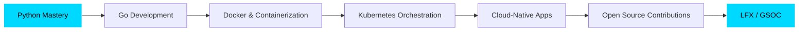

<div align="center">

# 👋 Hey there, I'm Nishant!


<p align="center">
  <a href="https://github.com/nishantbkl3345-ship-it"></a>
  <a href="https://github.com/nishantbkl3345-ship-it"></a>
</p>

</div>

---

## 🌟 About Me

```python
class Developer:
    def __init__(self):
        self.name = "Nishant"
        self.role = "Self-Taught Developer"
        self.location = "India 🇮🇳"
        self.currently_learning = ["Go", "Docker", "Kubernetes"]
        self.interests = ["Open Source", "Linux", "AI Systems", "Algorithms"]
        self.goal = "Contributing to LFX & GSOC"
    
    def say_hi(self):
        print("Thanks for stopping by! Let's build something amazing together.")

me = Developer()
me.say_hi()
```


- 🔭 **Current Focus:** Mastering **Go, Docker & Kubernetes**
- 🌱 **Learning Journey:** Deep-diving into **Linux internals** and **distributed systems**
- 🎯 **2025 Goal:** Contribute to **FOSSASIA** and participate in **LFX/GSOC**
- 💡 **Philosophy:** *"Learning by building, contributing by understanding"*
- 📚 **Approach:** Reading real-world code, fixing issues, building systems from scratch
- ⚡ **Fun Fact:** I believe the best way to learn is to break things and fix them!

<br clear="right"/>

---
## 🌐 Connect With Me

<div align="center">

[](https://linkedin.com/in/yourprofile)
[](https://twitter.com/yourhandle)
[](mailto:your.email@example.com)

</div>

---

## 🛠️ Tech Stack & Tools

<div align="center">

### Languages & Frameworks


### DevOps & Tools


### Data & APIs


</div>

---

## 🚀 Featured Projects

<div align="center">

<table>
<tr>
<td width="50%">

### 🎪 [eventyay](https://github.com/nishantbkl3345-ship-it/eventyay)
**FOSSASIA Fork** | Event Management Platform

```yaml
Tech: Python, Flask, REST APIs
Focus: Large codebase navigation
License: Apache 2.0
```

🎯 Learning open-source contribution workflows and enterprise Python architecture

</td>
<td width="50%">

### 🤖 [susi_skill_data](https://github.com/nishantbkl3345-ship-it/susi_skill_data)
**FOSSASIA Fork** | SUSI.AI Skills Repository

```yaml
Tech: JSON, YAML
Focus: AI skill data structures
License: GNU LGPL v2.1
```

🎯 Understanding data-driven AI systems and conversational design

</td>
</tr>

<tr>
<td width="50%">

### 🔍 [Search Algorithms Explainer](https://github.com/nishantbkl3345-ship-it/Search_Algorithms_Explainer)
Educational algorithm visualization project

```yaml
Tech: Python
Algorithms: Linear, Binary Search
Purpose: Learning fundamentals
```

🎯 Mastering core CS concepts through implementation

</td>
<td width="50%">

### 💼 [OJT Project](https://github.com/nishantbkl3345-ship-it/OJT-)
Custom Linux CLI for algorithm execution

```yaml
Tech: Python, Linux CLI
Focus: System-level programming
Innovation: Terminal-based workflows
```

🎯 Building practical Linux tools for algorithm practice

</td>
</tr>
</table>

</div>

---

## 🎯 Current Learning Path



---


## 💭 Recent Activity

<!--START_SECTION:activity-->
<!--END_SECTION:activity-->

---
<div align="center">

### 💡 *"Open Source First. Learning Always. Building Forever."* 🚀


**⭐ If you find my work interesting, consider giving a star to my repositories!**

---


</div>
